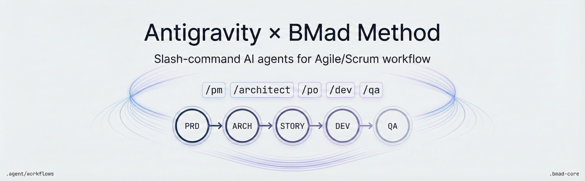

# Antigravity × BMad Method — Config Template

Language: English • `README_RU.md`

A ready-to-clone template that wires the **BMad Method** into **Google
Antigravity** the native way: a **pinned** BMAD install with Antigravity
skill targets, an orchestrator plugin, and language/team presets —
including a Russian one.

> **v2 (Oct 2026).** The v1 approach (`.agent/workflows` slash commands +
> `.bmad-core` transpose) is retired: Antigravity sunset workflows on
> **2026-10-19**, and BMAD ≥ 6 ships native Antigravity installer targets.
> See [Migrating from v1](#migrating-from-v1).

## What you get

| Layer | What | Where |
|---|---|---|
| **Pinned BMAD install** | one command installs `bmad-method` 6.12.4 with skills for both Antigravity targets (IDE/App `.agent/skills/`, CLI `.agents/skills/`) | `setup.sh` + `.bmad-version` |
| **Orchestrator plugin** | `/bmad-orchestrate` skill + two rules: routes work across BMad personas (Clarify → Plan → Build → Learn), detects artifact state, protects the runtime | `.agents/plugins/antigravity-bmad/` |
| **Presets** | durable team-layer config (`_bmad/custom/` — survives BMAD updates): English (default) and Russian (RU conversation / EN artifacts) | `presets/` |

## Requirements

- **Antigravity**: 2.0 App, IDE extensions (VS Code/JetBrains/…), or `agy` CLI
- **Node ≥ 20.12**
- **uv + Python 3.11** — only for `bmad-build` / `bmad-build-auto` (setup warns, proceeds without)

## Quick start

```bash
git clone https://github.com/salacoste/antigravity-bmad-config.git my-project
cd my-project && rm -rf .git && git init
./setup.sh            # or: ./setup.sh russian
```

Then open the folder in Antigravity and run:

- `/bmad-orchestrate` — this template's entry point ("start a project",
  "what's next", phase handoffs)
- `/bmad-help` — upstream orientation skill

Planning artifacts (PRD, architecture, epics, stories) land in
`_bmad-output/`. Everything the installer generates is gitignored;
re-run `./setup.sh` any time to restore or update.

## The BMad skill set (installed)

**Personas** — `/bmad-agent-analyst` (Mary), `/bmad-agent-pm` (John),
`/bmad-agent-ux-designer` (Sally), `/bmad-agent-architect` (Winston),
`/bmad-agent-dev` (Amelia).

**Plan** — `bmad-product-brief`, `bmad-prfaq`, `bmad-prd`, `bmad-ux`,
`bmad-architecture`, `bmad-spec`, `bmad-create-epics-and-stories`,
`bmad-sprint-planning`, `bmad-project-context`, `bmad-brainstorming`,
`bmad-forge-idea`.

**Ship** — `bmad-build`, `bmad-build-auto`, `bmad-code-review`,
`bmad-correct-course`, `bmad-qa-generate-e2e-tests`, `bmad-retrospective`,
`bmad-walkthrough`.

**Core** — `bmad-help`, `bmad-review`, `bmad-deep-recon`,
`bmad-advanced-elicitation`, `bmad-customize`, `bmad-party-mode`.

Full docs: [bmadcode.com](https://bmadcode.com) •
[docs.bmad-method.org](https://docs.bmad-method.org)

## Adding to an existing project (without the template)

Copy `.agents/plugins/antigravity-bmad/` into your project's
`.agents/plugins/`, then run the pinned installer:

```bash
npx bmad-method@6.12.4 install --yes --modules bmm --tools antigravity,antigravity-cli
```

Prefer copying the plugin from the **latest release tag** of this repo so
the plugin and the pin stay in sync.

## Updating / changing the pin

```bash
make update                 # re-run setup (installer detects existing install)
make verify-pin             # npm still serves the pinned version?
make smoke-test             # fresh-clone simulation + layout assertions
```

To move to a newer BMAD: edit `.bmad-version`, run `make smoke-test`,
fix breakage. CI runs the same checks on every push and weekly.

## Migrating from v1

1. Antigravity side: workflows → skills — follow the official
   [migration guide](https://antigravity.google/docs/migration/workflows-to-skills/).
2. BMAD side: v4 `.bmad-core` → v6 `_bmad/` — the installer detects v4
   leftovers and offers to back them up; planning docs move to
   `_bmad-output/planning-artifacts/` (see the upstream
   [upgrade-to-v6 guide](https://github.com/bmad-code-org/BMAD-METHOD/blob/V6.12/docs/fr/how-to/upgrade-to-v6.md)).
3. Delete v1 leftovers: `.agent/workflows/`, `.bmad-core/`,
   `.claude/commands/BMad/`, `.cursor/rules/bmad/`, `.gemini/commands/BMad/`,
   `transpose_bmad.py`, and the generated `AGENTS.md`.

## Repository structure

```
setup.sh / Makefile / .bmad-version / scripts/smoke-test.sh
presets/{english,russian}/            # team-layer preset sources
.agents/plugins/antigravity-bmad/     # orchestrator skill + rules (the plugin)
.github/workflows/ci.yml              # pin check + smoke test
assets/                               # images
AGENTS.md                             # orientation for coding agents (this repo)
```

## Contributing & License

See `CONTRIBUTING.md`. MIT — see `LICENSE`. The BMAD Method itself is a
separate MIT project ([bmad-code-org/BMAD-METHOD](https://github.com/bmad-code-org/BMAD-METHOD));
this repo only pins it and adds configuration/wrappers.
